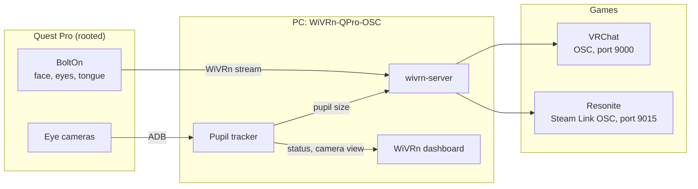
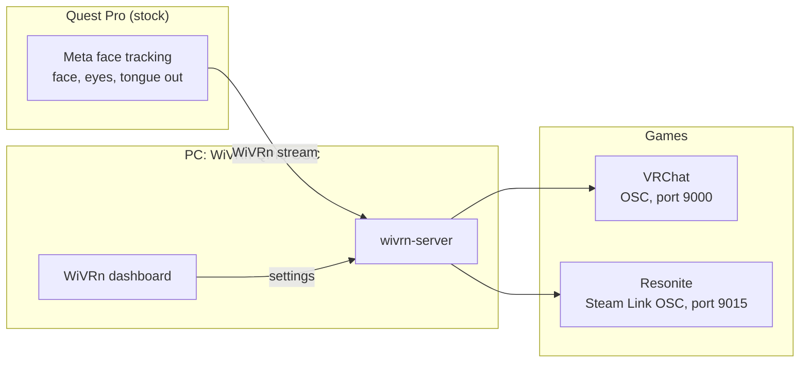
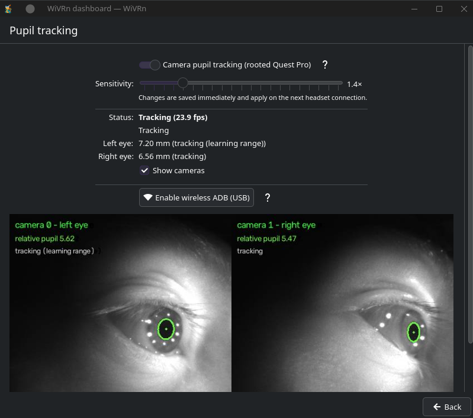

<h1 align="center"> WiVRn-QPro-OSC </h1>

<p align="center"><b>A fork of <a href="https://github.com/WiVRn/WiVRn">WiVRn</a> that sends Quest Pro face, eye, tongue and camera pupil tracking straight to VRChat and Resonite over OSC.</b></p>

One app: no VRCFaceTracking, no ALXR module, no Edrakon, nothing else to run on the PC. Start WiVRn, connect the headset and jump into VRChat or Resonite.

> [!IMPORTANT]
> This is an unofficial fork. Please [**report problems here**](https://github.com/Seventh-Void/WiVRn-QPro-OSC/issues/new/choose), not to the WiVRn project.
> Everything else is stock WiVRn 26.9, and its documentation (further down this page) applies.

## What this fork adds

| Feature | Where | Notes |
|---|---|---|
| **Face tracking over OSC (VRChat, Resonite)** | Dashboard → Settings → Advanced options | One switch for both games. Takes effect when the server restarts (the dashboard offers **Restart now**). |
| VRChat | UDP `127.0.0.1:9000` | VRCFaceTracking v2 (Unified Expressions) avatar parameters, including binary (`Name1/2/4/8…`) and `Negative` parameters. The avatar's parameters are read from VRChat's OSCQuery, so only what the avatar uses is sent. VRChat's native eye tracking (`/tracking/eye/…`) is sent for avatars without their own eye parameters. |
| Resonite | UDP `127.0.0.1:9015` | Steam Link OSC (what Edrakon provides): face, tongue out and combined gaze. Sent only while Resonite runs and Edrakon does not. |
| **Pupil tracking** page | Dashboard → Pupil tracking | Camera-measured pupil size on a **rooted** Quest Pro, done by WiVRn itself: it starts the eye cameras on the headset over ADB, finds the pupils and learns each eye's bright-to-dark range while you play. Live status, per-eye values and camera view. Pupils go to VRChat (`PupilDilation`, `PupilDiameter…`). |
| Tongue | automatic | Tongue out works on any Quest Pro. Advanced tongue tracking (left/right/up/down) needs BoltOn, whose tongue layout ("TongueHack", FB face tracking 2 slots 63–67) is mapped to tongue out/left/right/up/down, so VRCFaceTracking's ALXR module setting is not needed. |
| **Frame timing for overlays** (fpsVR-style) | `/dev/shm/wivrn-frametime`, [contrib/wayvr-fpsvr](contrib/wayvr-fpsvr) | WiVRn publishes each frame's CPU and GPU time for the focused app, with its name. The contrib folder puts it on the [WayVR](https://github.com/wlx-team/wayvr) watch: frame time graphs, FPS, temperatures, load and memory, game and VRChat world time, a Hide/Show stats button, and an on/off switch in the dashboard Settings. |

The headset app is **unchanged**: use the normal WiVRn 26.9 app (Meta Store, or the dashboard's install wizard).

### How it fits together

**Rooted Quest Pro** (BoltOn, camera pupils):



**Stock Quest Pro** (no root):



### Screenshots

<p align="center">
  <br>
  <i>Settings → Advanced options: one switch for VRChat and Resonite</i>
</p>

<p align="center">
  <br>
  <i>Pupil tracking page on a Quest Pro with BoltOn: both pupils detected, live eye camera view</i>
</p>

## Rooted or not: same release

There is one release for everyone. Camera pupil tracking is off until you turn it on, so a stock Quest Pro uses the same packages and simply skips that part.

| | Stock Quest Pro (no root) | Rooted Quest Pro with BoltOn |
|---|---|---|
| Face expressions (VRChat, Resonite) | ✅ | ✅ |
| Eye gaze and blinking | ✅ | ✅ |
| Tongue out | ✅ (native) | ✅ |
| Advanced tongue tracking (left / right / up / down) | ❌ | ✅ |
| Camera pupil size | ❌ | ✅ |

### Stock Quest Pro (no root)

1. On the headset: **Settings → Movement tracking** → turn on **Eye tracking** and **Face tracking**.
2. In the WiVRn headset app: **Settings** → turn on **Face tracking** and **Eye tracking**, and allow the permissions it asks for.
3. On the PC, follow [VRChat and Resonite](#step-3-face-tracking-in-vrchat-and-resonite) below. Leave **Camera pupil tracking** off and skip the ADB steps.

### Rooted Quest Pro: BoltOn

Face, eye and tongue tracking come from [BoltOn](https://guides.mxr.lol/guides/bolton/). Follow its guide, then leave it in **VRCFT mode** (the default): BoltOn's Direct mode does not support WiVRn, and in VRCFT mode WiVRn receives BoltOn's data and this fork takes the place of VRCFaceTracking and the ALXR Local Module on the PC. For pupils, see [Camera pupil tracking](#step-4-optional-camera-pupil-tracking-rooted-quest-pro).

## Install

This fork is **two separate things**. Install Part 1 to use the fork; Part 2 is an optional extra on top.

| | What it does | Needed? |
|---|---|---|
| **[Part 1: WiVRn-QPro-OSC](#part-1-wivrn-qpro-osc-face-tracking-to-vrchat-and-resonite)** | WiVRn itself, plus Quest Pro face, eye, tongue and pupil tracking straight to VRChat and Resonite over OSC. | Yes |
| **[Part 2: WayVR watch stats](#part-2-wayvr-watch-stats-optional)** | fpsVR-style FPS, frame time graphs, temperatures and memory on the [WayVR](https://github.com/wlx-team/wayvr) wrist watch. | Optional (needs Part 1) |

### What to download from the release

From the [latest release](https://github.com/Seventh-Void/WiVRn-QPro-OSC/releases/latest), download only the rows you need:

| Part | Your distribution | Files to download |
|---|---|---|
| 1 | Arch Linux, CachyOS, EndeavourOS, Manjaro | `wivrn-server-26.9-4-x86_64.pkg.tar.zst`, `wivrn-dashboard-26.9-4-x86_64.pkg.tar.zst` |
| 1 | Fedora, Debian, Ubuntu, Mint | nothing: you build it with the commands below |
| 2 | Arch Linux, CachyOS, EndeavourOS, Manjaro | `wayvr-26.8.0-1.3-x86_64.pkg.tar.zst` |
| 2 | Fedora, Debian, Ubuntu, Mint | nothing for WayVR: you build it with the commands below |
| 2 | every distribution | `wayvr-stats`, `wayvr-stats.path`, `wayvr-stats.service`, `fpsvr-icons.tar.gz`, and **either** `watch.xml` / `watch-purple.xml` (replace your watch) **or** `fpsvr-stats.xml`, `fpsvr-button.xml`, `fpsvr-clock.xml` (add to your own watch) |
| all | all | `SHA256SUMS`, to check the downloads: `sha256sum -c --ignore-missing SHA256SUMS` |

The headset app is the stock **WiVRn 26.9** app (Meta Store, or the dashboard's install wizard): nothing to download from here.

The Arch packages are what this fork is developed and tested on. For Fedora, Debian, Ubuntu and Mint, every package name below was checked against that distribution's repositories, but the full build hasn't been run there yet: if a step fails, please [open an issue](https://github.com/Seventh-Void/WiVRn-QPro-OSC/issues/new/choose) with the error.

## Part 1: WiVRn-QPro-OSC (face tracking to VRChat and Resonite)

### Step 1: install WiVRn-QPro-OSC

Pick your distribution.

#### Arch Linux, CachyOS, EndeavourOS, Manjaro

With the two downloaded packages, in the folder you downloaded them to:

```sh
sha256sum -c --ignore-missing SHA256SUMS
sudo pacman -U wivrn-server-26.9-4-x86_64.pkg.tar.zst wivrn-dashboard-26.9-4-x86_64.pkg.tar.zst
```

Or build the packages yourself instead:

```sh
sudo pacman -S --needed base-devel git
git clone -b v26.9-qpro.4 https://github.com/Seventh-Void/WiVRn-QPro-OSC.git ~/WiVRn-QPro-OSC
cd ~/WiVRn-QPro-OSC/archlinux
makepkg -si
cd ~
```

These packages replace the AUR packages of the same name (same version, newer package release, so AUR updates don't overwrite them). To go back to stock WiVRn, install the AUR packages again (for example `yay -S wivrn-server wivrn-dashboard`; pacman reports a downgrade).

#### Fedora 43

1. Install the build dependencies:

   ```sh
   sudo dnf install -y gcc-c++ cmake ninja-build git pkgconf-pkg-config glslang python3 gettext \
     avahi-devel ffmpeg-free-devel libbsd-devel boost-devel libcap-devel cjson-devel cli11-devel eigen3-devel \
     mesa-libGL-devel libnotify-devel pipewire-devel systemd-devel libva-devel vulkan-loader-devel vulkan-headers \
     wayland-devel libX11-devel libXrandr-devel json-devel libarchive-devel librsvg2-devel libpng-devel \
     openssl-devel libcurl-devel fontconfig-devel libdrm-devel glib2-devel opencv-devel android-tools \
     qt6-qtbase-devel qt6-qtbase-private-devel qt6-qtdeclarative-devel qt6-qttools-devel qcoro-qt6-devel \
     extra-cmake-modules kf6-kirigami-devel kf6-ki18n-devel kf6-kcoreaddons-devel kf6-qqc2-desktop-style \
     kf6-kiconthemes-devel kf6-kirigami-addons
   ```

   Fedora has no x264 in its main repositories, so WiVRn uses the hardware encoders only (VAAPI or Vulkan on AMD and Intel, NVENC on NVIDIA).

2. Build and install: [the build commands below](#build-and-install-fedora-debian-ubuntu-2604).

#### Debian 13, Ubuntu 26.04 LTS

1. Install the build dependencies:

   ```sh
   sudo apt update
   sudo apt install -y build-essential cmake ninja-build git pkg-config glslang-tools python3 gettext \
     libavahi-client-dev libavahi-glib-dev libavcodec-dev libavfilter-dev libavutil-dev libswscale-dev \
     libbsd-dev libboost-all-dev libcap-dev libcjson-dev libcli11-dev libeigen3-dev libgl-dev libnotify-dev \
     libpipewire-0.3-dev libsystemd-dev libudev-dev libva-dev libvulkan-dev libwayland-dev libx11-xcb-dev \
     libx264-dev libxcb-randr0-dev libxrandr-dev nlohmann-json3-dev libarchive-dev librsvg2-dev libpng-dev \
     libssl-dev libcurl4-openssl-dev libfontconfig-dev libdrm-dev libglib2.0-dev libopencv-dev adb \
     android-sdk-platform-tools-common \
     qt6-base-dev qt6-base-private-dev qt6-declarative-dev qt6-declarative-private-dev qt6-tools-dev qcoro-qt6-dev \
     extra-cmake-modules libkirigami-dev libkf6i18n-dev libkf6coreaddons-dev libkf6qqc2desktopstyle-dev \
     libkf6iconthemes-dev qml6-module-org-kde-kirigami qml6-module-org-kde-kirigamiaddons-components \
     qml6-module-org-kde-kirigamiaddons-formcard qml6-module-qtquick-dialogs
   ```

2. Build and install: [the build commands below](#build-and-install-fedora-debian-ubuntu-2604).

#### Build and install (Fedora, Debian, Ubuntu 26.04)

```sh
git clone -b v26.9-qpro.4 https://github.com/Seventh-Void/WiVRn-QPro-OSC.git ~/WiVRn-QPro-OSC
cd ~/WiVRn-QPro-OSC
cmake -B build -G Ninja -DGIT_TAG=v26.9 -DCMAKE_BUILD_TYPE=RelWithDebInfo -DCMAKE_INSTALL_PREFIX=/usr \
      -DWIVRN_BUILD_SERVER=ON -DWIVRN_BUILD_DASHBOARD=ON -DWIVRN_BUILD_CLIENT=OFF -DWIVRN_BUILD_WIVRNCTL=ON \
      -DWIVRN_OPENXR_MANIFEST_TYPE=relative -Wno-dev
cmake --build build
sudo cmake --install build
sudo setcap CAP_SYS_NICE=+ep /usr/bin/wivrn-server
cd ~
```

`-DGIT_TAG=v26.9` keeps the version the same as upstream, so the dashboard installs the matching stock headset app. `setcap` lets the server run its threads at a higher priority (the Debian package of WiVRn does the same); run it again after every rebuild.

#### Linux Mint 22, Ubuntu 24.04 LTS

These have no KDE Frameworks 6, so the **WiVRn dashboard can't be built**: you get the server only, set up through a config file (see [Without the dashboard](#without-the-dashboard)). Install the headset app from the Meta Store.

```sh
sudo apt update
sudo apt install -y build-essential cmake ninja-build git pkg-config glslang-tools python3 gettext \
  libavahi-client-dev libavahi-glib-dev libavcodec-dev libavfilter-dev libavutil-dev libswscale-dev \
  libbsd-dev libboost-all-dev libcap-dev libcjson-dev libcli11-dev libeigen3-dev libgl-dev libnotify-dev \
  libpipewire-0.3-dev libsystemd-dev libudev-dev libva-dev libvulkan-dev libwayland-dev libx11-xcb-dev \
  libx264-dev libxcb-randr0-dev libxrandr-dev nlohmann-json3-dev libarchive-dev librsvg2-dev libpng-dev \
  libssl-dev libcurl4-openssl-dev libfontconfig-dev libdrm-dev libglib2.0-dev libopencv-dev adb \
  android-sdk-platform-tools-common
git clone -b v26.9-qpro.4 https://github.com/Seventh-Void/WiVRn-QPro-OSC.git ~/WiVRn-QPro-OSC
cd ~/WiVRn-QPro-OSC
cmake -B build -G Ninja -DGIT_TAG=v26.9 -DCMAKE_BUILD_TYPE=RelWithDebInfo -DCMAKE_INSTALL_PREFIX=/usr \
      -DWIVRN_BUILD_SERVER=ON -DWIVRN_BUILD_DASHBOARD=OFF -DWIVRN_BUILD_CLIENT=OFF -DWIVRN_BUILD_WIVRNCTL=ON \
      -DWIVRN_OPENXR_MANIFEST_TYPE=relative -Wno-dev
cmake --build build
sudo cmake --install build
sudo setcap CAP_SYS_NICE=+ep /usr/bin/wivrn-server
cd ~
```

### Step 2: let the headset find the PC

Every distribution:

```sh
sudo systemctl enable --now avahi-daemon
```

If you use a firewall, open mDNS (5353/udp) and WiVRn (9757/tcp and udp):

```sh
# firewalld (Fedora):
sudo firewall-cmd --permanent --add-service=mdns --add-port=9757/tcp --add-port=9757/udp && sudo firewall-cmd --reload
# ufw (Ubuntu, Mint):
sudo ufw allow 5353/udp && sudo ufw allow 9757
```

Then start **WiVRn server** from your application menu (`wivrn-dashboard`), or run `wivrn-server` without the dashboard, and connect the WiVRn app in the headset.

### Step 3: face tracking in VRChat and Resonite

1. Open the WiVRn dashboard → **Settings** → **Advanced options** → tick **Face tracking over OSC (VRChat, Resonite)** → **OK**. (No dashboard: see [Without the dashboard](#without-the-dashboard).)
2. If the server was already running, restart it (**Restart now** in the dashboard), then connect the headset.
3. **VRChat:** enable OSC (Action menu → Options → OSC → Enabled) and use an avatar with VRCFaceTracking v2 parameters.
4. **Resonite:** install [ResoniteModLoader](https://github.com/resonite-modding-group/ResoniteModLoader) and [RemoveThatKinkFromSteamLinkCS](https://github.com/PointerOffset/RemoveThatKinkFromSteamLinkCS) (Resonite only listens for Steam Link face tracking with it), and close Edrakon.

To send to VRChat on another address, edit `~/.config/wivrn/config.json`:

```json
"vrchat-osc": { "host": "127.0.0.1", "port": 9000 }
```

### Step 4 (optional): camera pupil tracking (rooted Quest Pro)

1. `adb` must see the headset: plug it in over USB, accept the prompt in the headset, and check that `adb devices` lists it. If it shows `no permissions`, install your distribution's udev rules for Android devices (`android-udev` on Arch, `android-sdk-platform-tools-common` on Debian/Ubuntu/Mint, `android-tools` on Fedora) and reconnect.
2. Root access for ADB: in Magisk → Superuser, allow **Shell**.
3. Wireless ADB: with the headset on USB, open the dashboard → **Pupil tracking** → **Enable wireless ADB (USB)**, then unplug. Repeat after each headset reboot. (No dashboard: run `adb tcpip 5555` instead.)
4. On the same page, turn on **Camera pupil tracking** and pick a sensitivity, press **Restart now** if the server was running, then connect the headset (with face tracking over OSC on).

Values settle after a few minutes of play, as each eye's range is learned (bright scenes and dark scenes both help). Tick **Show cameras** to see what the eye cameras see.

### Without the dashboard

Mint 22 / Ubuntu 24.04 (or anyone using `wivrn-server` alone) set the fork's options in `~/.config/wivrn/config.json` and restart `wivrn-server`:

```json
{
  "vrchat-osc": { "host": "127.0.0.1", "port": 9000 },
  "qpro-pupils": { "sensitivity": 1.4 }
}
```

`vrchat-osc` turns on face tracking over OSC; `qpro-pupils` turns on camera pupil tracking (sensitivity 1.0 to 2.0). Leave a key out to keep that feature off.

### Ports used

| Port | Direction | Purpose |
|---|---|---|
| UDP 9000 | out | VRChat OSC |
| UDP 9015 | out | Resonite (Steam Link OSC) |
| TCP 27273 | local (ADB forward) | Eye camera stream from the headset |
| TCP 8081 | local | Pupil status and camera view for the dashboard |

The Flatpak is not supported.

## Part 2: WayVR watch stats (optional)

<p align="center"></p>

FPS, frame time graphs, temperatures, load and memory on the [WayVR](https://github.com/wlx-team/wayvr) wrist watch, like fpsVR on SteamVR. Separate from Part 1: it only reads the frame times Part 1 publishes, and you can skip it entirely. Full details (what each number means, settings, NVIDIA support, troubleshooting): [contrib/wayvr-fpsvr](contrib/wayvr-fpsvr).

### Step 1: the patched WayVR

The patched WayVR 26.8.0 adds **Settings → FPS stats** and fixes two WayVR crashes (one of them after ~22 minutes of graphs). Install it instead of your distribution's WayVR.

#### Arch Linux, CachyOS, EndeavourOS, Manjaro

With the downloaded package:

```sh
sudo pacman -U wayvr-26.8.0-1.3-x86_64.pkg.tar.zst
```

Or build it yourself (needs the `~/WiVRn-QPro-OSC` clone from Part 1, or clone it now):

```sh
[ -d ~/WiVRn-QPro-OSC ] || git clone -b v26.9-qpro.4 https://github.com/Seventh-Void/WiVRn-QPro-OSC.git ~/WiVRn-QPro-OSC
cd ~/WiVRn-QPro-OSC/contrib/wayvr-fpsvr/wayvr-pkg
makepkg -si
cd ~
```

#### Fedora 43, Debian 13, Ubuntu, Mint

1. Install the build dependencies.

   Fedora:

   ```sh
   sudo dnf install -y gcc-c++ cmake git pkgconf-pkg-config python3 curl patch \
     libxkbcommon-devel libxkbcommon-x11-devel libX11-devel libxcb-devel libXext-devel libXrandr-devel \
     dbus-devel libinput-devel alsa-lib-devel openxr-devel libdav1d-devel pipewire-devel wayland-devel \
     openssl-devel fontconfig-devel vulkan-loader-devel vulkan-headers clang clang-devel glslc libshaderc-devel
   ```

   Debian, Ubuntu, Mint:

   ```sh
   sudo apt update
   sudo apt install -y build-essential cmake git pkg-config python3 curl patch \
     libxkbcommon-dev libxkbcommon-x11-dev libx11-dev libxcb1-dev libxext-dev libxrandr-dev \
     libdbus-1-dev libinput-dev libasound2-dev libopenxr-dev libdav1d-dev libpipewire-0.3-dev libwayland-dev \
     libssl-dev libfontconfig-dev libvulkan-dev clang libclang-dev glslc libshaderc-dev
   ```

2. Build and install. This uses [rustup](https://rustup.rs) (installs Rust for your user only, in `~/.cargo`), because the distributions' Rust is older than WayVR needs. OpenVR support is left out (not packaged everywhere; WiVRn uses OpenXR).

   ```sh
   [ -d ~/WiVRn-QPro-OSC ] || git clone -b v26.9-qpro.4 https://github.com/Seventh-Void/WiVRn-QPro-OSC.git ~/WiVRn-QPro-OSC
   curl --proto '=https' --tlsv1.2 -sSf https://sh.rustup.rs | sh -s -- -y --profile minimal
   . "$HOME/.cargo/env"
   cd ~
   curl -L -o wayvr-26.8.0.tar.gz https://github.com/wayvr-org/wayvr/archive/refs/tags/v26.8.0.tar.gz
   echo "8db6d52b8be462b132d05c119b526094bef9fbe4b8b605dec44e5979f41256ef  wayvr-26.8.0.tar.gz" | sha256sum -c
   tar xf wayvr-26.8.0.tar.gz
   cd wayvr-26.8.0
   for p in glyph-atlas-trim screencast-status-crash fpsvr-settings-tab; do
     patch -Np1 -i ~/WiVRn-QPro-OSC/contrib/wayvr-fpsvr/wayvr-pkg/$p.patch
   done
   (cd wayvr && cargo build --release --no-default-features --features openxr,osc,wayland,whisper,x11)
   (cd wayvrctl && cargo build --release)
   sudo install -Dm755 -t /usr/local/bin target/release/wayvr target/release/wayvrctl
   cd ~
   ```

### Step 2: the stats script and the watch

Every distribution, in the folder with the release downloads (or `~/WiVRn-QPro-OSC/contrib/wayvr-fpsvr`). Nothing here needs root:

```sh
[ -f fpsvr-icons.tar.gz ] && tar xf fpsvr-icons.tar.gz   # release downloads: unpacks fpsvr/
install -Dm755 wayvr-stats ~/.local/bin/wayvr-stats
install -Dm644 -t ~/.config/systemd/user wayvr-stats.path wayvr-stats.service
install -Dm644 -t ~/.config/wayvr/theme/fpsvr fpsvr/*.svg
systemctl --user daemon-reload
systemctl --user enable --now wayvr-stats.path
[ -f ~/.config/wayvr/theme/gui/watch.xml ] && cp ~/.config/wayvr/theme/gui/watch.xml ~/.config/wayvr/theme/gui/watch.xml.bak
install -Dm644 watch.xml ~/.config/wayvr/theme/gui/watch.xml   # or watch-purple.xml
```

This replaces your watch (the old one is kept as `watch.xml.bak`). To keep your own watch and add the stats to it instead, use the add-on files: [contrib/wayvr-fpsvr → option B](contrib/wayvr-fpsvr#2-the-watch).

### Step 3: start it

Restart WayVR (`wayvr --replace`, or close and start it). The stats start by themselves with WayVR from now on. Change what they show in WayVR's **Settings → FPS stats**; turn them off in the WiVRn dashboard → **Settings** → **fpsVR-style stats on the WayVR watch** (or `"wayvr-stats": false` in `~/.config/wivrn/config.json`).

## Credits and licenses

- [WiVRn](https://github.com/WiVRn/WiVRn) by Guillaume Meunier and contributors (GPL-3.0). This fork is GPL-3.0 as well.
- Expression mapping and parameter encoding follow [VRCFaceTracking](https://github.com/benaclejames/VRCFaceTracking) (Apache-2.0) and [VRCFT-ALXR-Modules](https://github.com/korejan/VRCFT-ALXR-Modules) (MIT).
- Steam Link OSC format: [LinkFT](https://github.com/ykeara/LinkFT)'s notes (MIT) and [danwillm's VRCFT-SteamLink](https://github.com/danwillm/VRCFT-SteamLink).
- The headset eye-camera helpers (`server/qpro_pupil/headset/`) and the pupil detector are from [Qpro-Enhanced-FT-Wireless](https://github.com/Fwooffy/Qpro-Enhanced-FT-Wireless), based on [Qpro-Enhanced-FT by n0tmast3r](https://github.com/n0tmast3r/Qpro-Enhanced-FT) (MIT, QproFaceTracking contributors).
- [BoltOn](https://guides.mxr.lol/guides/bolton/) by Walaryne provides the headset face tracking.

Not affiliated with or endorsed by WiVRn, Meta, VRChat, Resonite, VRCFaceTracking or BoltOn.

---

<p align="center"><i>The original WiVRn README follows.</i></p>

<h1 align="center"> WiVRn </h1>

<div align="center">
  
[](https://www.gnu.org/licenses/gpl-3.0)  
  
</div>
<p align="center"></p>
<h3 align="center">Fully FOSS PCVR streamer</h3>

# About

WiVRn is an application that wirelessly streams a virtual reality game to a standalone VR headset from a <b>Linux</b> computer.

WiVRn support a wide range of VR devices:

| Headset | Supported | Notes |
|:--------:|:--------:|:--------:|
| Quest 1 | ✓ |  |
| Quest 2 | ✓ |  |
| Quest 3 | ✓ |  |
| Quest 3s | ✓ |  |
| Quest Pro | ✓ |  |
| Pico Neo 3 | ✓ |  |
| Pico 4 | ✓ |  |
| HTC Vive Focus 3 | ✓ | Laggy | 
| HTC Vive XR Elite | ✓ | Laggy |
| Samsung Galaxy XR | ✓ |  |
| Other Android VR | ? | Cannot know |
| Play for Dream | ✖ | https://github.com/WiVRn/WiVRn/issues/465 |
| Non-Android VR | ✖ | Not Android |
| Non-VR Android | ✖ | VR required |

<sup>A Linux client does exist, only for debugging. It has no audio or hardware decoding.</sup>

# Getting started


## PC Server/Dashboard

We recommend using native packages if available for your distribution:
- [Arch User Repository](https://aur.archlinux.org/packages/wivrn-dashboard)
- [Fedora](https://packages.fedoraproject.org/pkgs/wivrn/wivrn/)
- [Gentoo Guru](https://gitweb.gentoo.org/repo/proj/guru.git/tree/media-libs/wivrn)
- [NixOS](https://search.nixos.org/packages?show=wivrn)

For OpenVR and Steam compatibility, you also need a compatibility library such as [xrizer](https://github.com/Supreeeme/xrizer/) or [OpenComposite](https://gitlab.com/znixian/OpenOVR/).

A Flatpak is available on Flathub for all distributions:

[](https://flathub.org/apps/io.github.wivrn.wivrn)

The Flatpak contains both xrizer and OpenComposite.

Note that due to Flatpak sandboxing, some features such as support for SteamVR tracked (Lighthouse) devices, or virtual gamepad/keyboard/input devices forwarded from the headset, may not be available.

## Headset Client/App

Follow the wizard in the PC dashboard to install the client on your VR headset.

It should either lead you to the [Meta Store](https://www.meta.com/experiences/7959676140827574/) (for Meta Quest headsets) or to download the correct APK (for other headsets).

> [!WARNING]
> The VR client and PC server need to be on the same version of WiVRn

> [!TIP]
> If the headset fails to connect to the computer, see [troubleshooting](#troubleshooting).


# Usage

## Running

### Prerequisites
Avahi must be running:
```bash
systemctl enable --now avahi-daemon
```

On SteamOS, the Avahi configuration needs to be modified to allow user services such as WiVRn to publish services on the network; see https://github.com/WiVRn/WiVRn/issues/1001#issuecomment-4940906113 for instructions on how to do so.

- If a firewall is installed, open port 5353/UDP for Avahi and ports 9757/UDP+TCP for WiVRn.
- For example, if using UFW run `ufw allow 5353/udp` and `ufw allow 9757`.

### Start the PC server process
The graphical frontend is listed as "WiVRn server" in the application list, and is `wivrn-dashboard` on command line. On first start, a wizard will guide you through the initial steps.

The actual server for headless usage is `wivrn-server`. When installed through your distribution's package manager, a systemd user service named `wivrn` is also installed, which can be enabled to automatically start on login with `systemctl --user enable --now wivrn`.

For Steam games, depending on the installation method, you may need to set launch options in the Steam properties for each game you want to run. Either the dashboard or command line output will display the launch command if it is required.

### Start the headset application
On the headset, when installed from the store, simply start `WiVRn`. If you installed the app via the dashboard, or manually via `adb`, it will be in an "unknown sources" section.

On first start, it will ask if you want to enable some features such as microphone, hand tracking, eye tracking, etc., as they will require permissions to be granted. It is possible to grant those later from the Settings tab.

It is highly recommended to use default settings and only tweak them if you experience issues.

### Connect to the server
The headset application will start on a server list. Your computer should be visible and have a connect button. Simply click it to start streaming.

When the headset is connected, wivrn-server sets the OpenXR and OpenVR configuration to use WiVRn. Thus, applications will only be able to run in VR once the headset connection is established. The configuration is reverted once the connection ends and all running VR applications are closed. 

The headset connection also triggers the creation of a virtual speaker and, if enabled in the headset app settings, a microphone. You will have to set them as the default output and input devices in your system audio configuration. This setting persists to future sessions until you change the defaults to other devices.

### Start an application
When the headset is connected and no XR application is running, it will show an application launcher. Applications in that list are sourced from:
- Steam games that are flagged as VR. Steam may need to be restarted for the list to be updated when new games are installed.
- .desktop files that contain `X-WiVRn-VR` in the `Categories` section. Files are searched in [standard locations](https://specifications.freedesktop.org/desktop-entry/latest/file-naming.html#desktop-file-id) which usually include `~/.local/share/applications` and `/usr/share/applications/`.

You can set an application to be started automatically when your headset is connected, in the dashboard settings or [manually](docs/configuration.md#application).

## Steam Flatpak
Flatpak applications are only able to access the Flatpak version of WiVRn.

If you're using the Steam Flatpak, you'll need to grant read only access to the following paths:

```bash
flatpak override \
  --filesystem=xdg-run/wivrn:ro \
  --filesystem=xdg-data/flatpak/app/io.github.wivrn.wivrn:ro \
  --filesystem=/var/lib/flatpak/app/io.github.wivrn.wivrn:ro \
  --filesystem=xdg-config/openxr:ro \
  --filesystem=xdg-config/openvr:ro \
  com.valvesoftware.Steam
```

When using a user installation of flatpak Steam, use `override --user` instead of `override`.

The same overrides should work for other VR applications distributed as Flatpaks.

# Building

See [building](docs/building.md) for building the [dashboard](docs/building.md#dashboard), [server (PC)](docs/building.md#server-pc), and [client (headset)](docs/building.md#client-headset)


# Configuration
Most settings are controlled through the headset app, while the server has configuration for items that are specific to the server. Use the dashboard to edit the latter, or see [configuration](docs/configuration.md) for editing it manually.

# Troubleshooting
<details><summary>My computer is not seen by the headset</summary>

If the server list is empty in the headset app:
- Make sure your computer is connected on the same network as your headset
- Check that avahi is running with `systemctl status avahi-daemon`, if it is not, enable it with `systemctl enable --now avahi-daemon`
- If you have a firewall, check that port 5353 (UDP) is open</details>

<details><summary>My headset does not connect to my computer</summary>
  
- If you have a firewall, check that port 9757 (UDP and TCP) is open
- The server and client must be the same version.</details>

<details><summary>How do I use a wired connection manually?</summary>

- Make sure the WiVRn Server is installed and running on your computer
- Make sure you have the WiVRn app installed on your headset
- After starting the "WiVRn Server" on your computer and ensuring your device is connected to your PC via cable, run the following in your terminal (Note: using `adb` on some devices may require developer mode to be enabled):
   - ```bash
      adb reverse tcp:9757 tcp:9757
      adb shell am start -a android.intent.action.VIEW -d "wivrn+tcp://localhost" org.meumeu.wivrn
      ```
   - Depending on your install type, you may need to replace `org.meumeu.wivrn` (Meta Store install) with:
      - `org.meumeu.wivrn.github` for [releases](https://github.com/WiVRn/WiVRn/releases) on Github
      - `org.meumeu.wivrn.github.nighly` for Github nightlies (wirvn-apk [repository](https://github.com/WiVRn/WiVRn-APK/releases))
      - `org.meumeu.wivrn.github.testing` for Github CI builds
      - `org.meumeu.wivrn.local` for developer builds
- You can now continue the pairing process as documented in the running section.</details>

<details><summary>How do I see server logs when using the dashboard?</summary>

- Click **Troubleshoot > Open server logs**
- Or, navigate to `${XDG_STATE_HOME}/wivrn/wivrn-dashboard`
  - In other words, on common setups, the dashboard writes logs to `~/.local/state/wivrn/wivrn-dashboard`
  - For WiVRn Flatpak, the dashboard writes logs to `~/.var/app/io.github.wivrn.wivrn/.local/state/wivrn/wivrn-dashboard`</details>

<details><summary>My NVIDIA GPU P-State is limited to P2 instead of reaching the highest P0 while using the NVIDIA NVENC encoder</summary>
    
- See [nvenc](docs/nvenc.md) for troubleshooting.</details>

<details><summary>I have high motion latency, black borders following my view, hear corrupted audio or see a corrupted, pixelated image</summary>

- When connecting through USB, make sure the headset isn't connected through WiFi (switch off WiFi)
- Reset the settings using the button at the bottom of the settings tab
- Try switching to software encoding
- Decrease the bitrate
- Decrease the resolution in the WiVRn app
- Connect through USB or use a better WiFi router.

Note: WiVRn isn't properly optimized for NVIDIA GPUs due to the lack of developers with NVIDIA hardware. Motion latency may be significantly worse at rendering resolutions higher than default.</details>

# Community Support

We are available on either **Discord** or **Matrix space**:

[](https://discord.gg/EHAYe3tTYa) [](https://matrix.to/#/#linux-vr-adventures:matrix.org)

Please use the `wivrn` chat room for questions or issues specific to WiVRn.


# Contributing

## Translations

See [translating](docs/translating.md) for procedure.


# Credits
WiVRn uses the following software:
- [ambientCG](https://ambientcg.com/)
- [Avahi](https://www.avahi.org/)
- [Boost.Locale](https://github.com/boostorg/locale)
- [Boost.PFR](https://github.com/boostorg/pfr)
- [CLI11](https://github.com/CLIUtils/CLI11)
- [Dear ImGui](https://github.com/ocornut/imgui)
- [fastgltf](https://github.com/spnda/fastgltf)
- [ffmpeg](https://ffmpeg.org/) optional, for hardware encoding on AMD/Intel
- [FreeType](https://freetype.org/)
- [glm](http://glm.g-truc.net/)
- [HarfBuzz](https://harfbuzz.github.io/)
- [librsvg](https://wiki.gnome.org/Projects/LibRsvg)
- [Monado](https://monado.freedesktop.org/)
- [nvenc](https://developer.nvidia.com/nvidia-video-codec-sdk) optional, for hardware encoding on NVIDIA
- [qCoro](https://qcoro.dev/)
- [Qt 6](https://www.qt.io/) optional, for the dashboard
- [spdlog](https://github.com/gabime/spdlog)
- [VulkanMemoryAllocator](https://github.com/GPUOpen-LibrariesAndSDKs/VulkanMemoryAllocator)
- [WebXR input profiles](https://www.npmjs.com/package/@webxr-input-profiles/motion-controllers)
- [x264](https://www.videolan.org/developers/x264.html) optional, for software encoding
