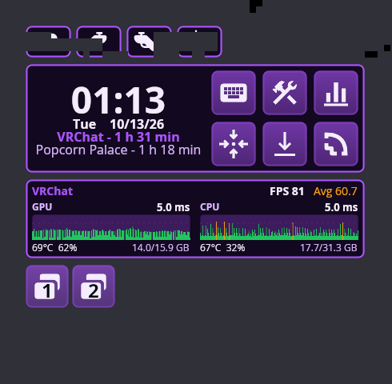
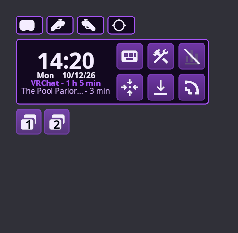
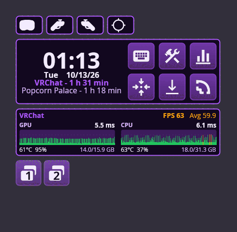
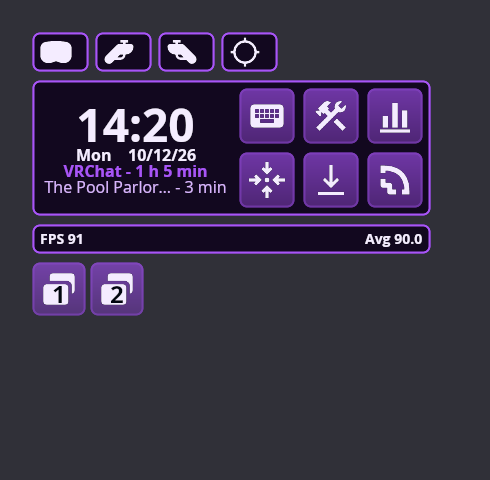
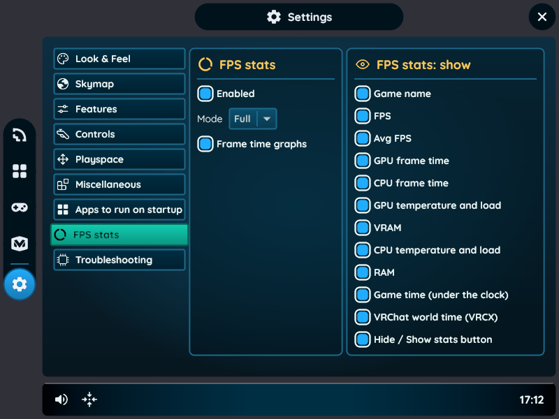
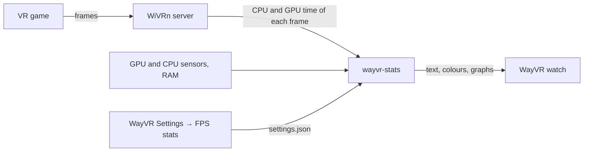

# fpsVR-style stats on the WayVR watch

A frame timing panel for [WayVR](https://github.com/wlx-team/wayvr)'s wrist watch, like fpsVR on SteamVR: per-frame CPU and GPU frame time graphs for the VR game you're in, FPS, temperatures, load and memory, plus how long you've been in the game (and, in VRChat, in the current world) under the clock. Everything can be changed live in WayVR's **Settings → FPS stats**.

<p align="center">
  
  
</p>
<p align="center">
  
  
</p>
<p align="center"></p>

*The watch images are from a real VRChat session on a Quest Pro with this fork, rendered with WayVR's `uidev` previewer (the dark background stands in for the game behind the watch; battery levels are left empty by the previewer). Top: the stats panel, and the same watch with the stats hidden. The GIF replays 24 s of recorded VRChat frames, world loading included, through the panel's own graph and colour code: FPS and frame times turn orange and red while the frames are late, and back to white once it recovers (the temperature, load and memory lines in it are from the moment of the screenshot). Next to it: Minimal mode. Bottom: the FPS stats tab of the patched WayVR's Settings.*

## How it works

Three parts work together, all on your PC:



1. **WiVRn server** (Part 1 of this fork) measures how long each frame of your game takes on the CPU and on the GPU, and shares those numbers in memory. Stock WiVRn doesn't do this.
2. **`wayvr-stats`**, a small Python script, reads those numbers 15 times a second, adds temperatures, load and memory from your system, works out FPS, and draws the graphs.
3. **WayVR** shows it all on the watch. The script talks to WayVR through `wayvrctl`, WayVR's own remote control, and only sends what changed.

You never start the script yourself. A systemd unit (`wayvr-stats.path`) starts it every time WayVR starts, and the script stops when WayVR closes. The Settings tab saves your choices to a small file that the script checks every 2 seconds, so changes show up without a restart. Hiding the stats with the watch button pauses the script, so it reads nothing until you show them again.

Technical details are [at the end](#technical-details).

## What it shows

| Item | Source |
|---|---|
| Game name | WiVRn: the focused (non-overlay) OpenXR app. |
| Game time (under the clock) | Time since the panel first saw the game in focus (restarting the panel or WayVR restarts it). Changes to `No VR game` 5 s after the game stops delivering frames. |
| World time (under the clock) | VRChat only, with [VRCX](https://github.com/vrcx-team/VRCX) running (see [VRCX](#vrcx-optional)): the current world and how long you've been in it. Blank otherwise. |
| FPS | Frames the game delivered in the last second. Shows `--` until a full second has passed. |
| Avg | Frames delivered since the panel first saw the game in focus, divided by the time since then. |
| GPU / CPU frame time and graphs | WiVRn, every frame of the focused game, any GPU vendor. CPU = app wake-up to `xrEndFrame`, GPU = `xrEndFrame` to its GPU work finishing. Graphs show the last 150 frames as bars; the dashed line is the frame budget for the headset's refresh rate. Frame time labels are the average over the last second. |
| GPU temperature and load, VRAM | See [GPU support](#gpu-support). |
| CPU temperature and load | `k10temp` (AMD, Tctl) or `coretemp` (Intel, package) temperature; load from `/proc/stat`. |
| RAM | `/proc/meminfo`: total minus available. |

Nothing is estimated. Anything this machine can't read stays `--`. The overlay itself (WayVR) is never counted: WiVRn only exports the focused game.

### GPU support

| GPU | Temperature, load, VRAM | Status |
|---|---|---|
| AMD (`amdgpu`) | sysfs: junction (hotspot) temperature, `gpu_busy_percent`, `mem_info_vram_*`. With several AMD GPUs (for example a Ryzen iGPU next to a Radeon card), the one with the most VRAM. | Tested (RX 9070 XT). |
| NVIDIA (proprietary driver) | NVML (`libnvidia-ml.so.1`, installed with the driver): GPU temperature, utilization, memory used/total, first GPU. | **Untested**: written without NVIDIA hardware. If it shows `--` or wrong values, please [report it](https://github.com/Seventh-Void/WiVRn-QPro-OSC/issues/new?template=wayvr_stats.yml) with your GPU and driver version. |
| Intel, NVIDIA with nouveau, anything else | not read | GPU line shows `--`; frame times, FPS and graphs still work. |

### Colours

The target is the headset's refresh rate (90 FPS at 90 Hz; frame budget 11.1 ms).

| | Fine | Orange | Red |
|---|---|---|---|
| Graph bars | green: within the budget | up to 25 % over | more than 25 % over |
| GPU / CPU ms | normal text colour | up to 25 % over | more than 25 % over |
| FPS / Avg | normal text colour | below 90 % of the target | below half the target |

### Hide and show

The square stats button in the clock box (next to the edit button) hides the panel (its icon is then crossed out) and shows it again. The watch keeps its size: the buttons below move up and the space at the bottom stays empty. While hidden, `wayvr-stats` stops reading frame times and sensors and sends nothing; only the game and world time under the clock keep counting. A new WayVR always starts with the stats shown.

### VRCX (optional)

The world time line comes from [VRCX](https://github.com/vrcx-team/VRCX), which logs every VRChat world you join. `wayvr-stats` reads VRCX's database (`~/.config/VRCX/VRCX.sqlite3`) read-only, every 5 s while VRChat is the focused game, and shows the newest world and how long ago you joined it (the same "time in current world" VRCX shows).

There is nothing to set up: if that database doesn't exist, the world time is off and the line stays blank (no errors, no work). Once VRCX is installed, it turns on by itself.

VRCX has to be **running** for the world time to show: only then does it log world changes, so while it's closed the line stays blank instead of showing a world you may have left. If you start VRCX after joining a world, the time shows from the next world you join.

## Settings

With the patched WayVR (`26.8.0-1.3`, see [Install](#install)): WayVR dashboard → **Settings** → **FPS stats**. Every change applies to the watch within 2 seconds, no restart needed, and is kept between sessions.

| Setting | |
|---|---|
| Enabled | Master switch, the same one as WiVRn dashboard → Settings → **fpsVR-style stats on the WayVR watch**. Off: the stats, the stats button and the time lines disappear from the watch and `wayvr-stats` does nothing. |
| Mode | **Full**: the panel as shown above. **Minimal**: FPS and Avg FPS only, in one line. |
| Frame time graphs | The GPU / CPU graphs. On by default. |
| FPS stats: show | One switch per element: game name, FPS, Avg FPS, GPU / CPU frame time (label and graph), GPU temperature and load, VRAM, CPU temperature and load, RAM, game time, VRChat world time, Hide / Show stats button. Used in Full mode. |

The tab writes `~/.config/wayvr-stats/settings.json`, and the master switch is `"wayvr-stats"` in `~/.config/wivrn/config.json`. Without the patched WayVR, edit `settings.json` by hand; `wayvr-stats` picks up changes within 2 seconds:

```json
{
  "mode": "full",
  "graphs": false,
  "show": { "vram": false, "world": false }
}
```

`mode` is `full` or `minimal`; `show` takes the keys `title`, `fps`, `avg`, `gpu_ms`, `cpu_ms`, `gpu`, `vram`, `cpu`, `ram`, `session`, `world`, `button` (left out means shown).

Colours are set in the service (`systemctl --user edit wayvr-stats.service`, then `systemctl --user restart wayvr-stats.service`):

| Variable | Default | |
|---|---|---|
| `WAYVR_STATS_COLOR` | `#FFFFFF` | Colour of the dashed frame budget line. |
| `WAYVR_STATS_TEXT` | `#FFFFFF` | Normal colour of FPS / Avg / ms (match your watch's text colour; `#F4ECFF` for `watch-purple.xml`). |

The rest of the watch colours are the theme variables at the top of `watch.xml`.

## Requirements

- `wivrn-server` from this fork, **v26.9-qpro.3 or later** (it writes `/dev/shm/wivrn-frametime`). Stock WiVRn doesn't export frame times; the panel then only shows the hardware stats.
- WayVR 26.8 with `wayvrctl`. Optional, for the Settings tab and a screen share crash fix: the patched WayVR **26.8.0-1.3** (see the [main README](../../README.md#install) for every distribution).
- Python 3 (standard library only) and a systemd user session (every distribution in the main README has both).
- Optional: VRCX, for the VRChat world time.

## Install

Download `wayvr-watch-stats.tar.gz` from the [latest release](https://github.com/Seventh-Void/WiVRn-QPro-OSC/releases/latest) (it holds everything in this folder that you need), and on Arch-based distributions also the patched WayVR, `wayvr-26.8.0-1.3-x86_64.pkg.tar.zst` (others build it, see the [main README](../../README.md#part-2-wayvr-watch-stats-optional)).

### 1. Run the installer

In the folder with the download (nothing here needs root):

```sh
tar xf wayvr-watch-stats.tar.gz
./wayvr-watch-stats/install.sh          # white watch
./wayvr-watch-stats/install.sh purple   # or the purple watch
./wayvr-watch-stats/install.sh keep     # or keep your own watch (see option B below)
```

From a clone of the repository, run `./install.sh` in this folder instead.

It copies `wayvr-stats` to `~/.local/bin`, the systemd user units and the icons into `~/.config`, and turns on `wayvr-stats.path`. The stats then start by themselves whenever WayVR starts, however it is launched, and follow WayVR across restarts and crashes (the service also restarts the script if it fails).

### 2. The watch

**A. Replace your watch** (`install.sh` or `install.sh purple`): the installer puts in the complete white or purple watch. Your old `watch.xml` is kept next to it as `watch.xml.<date>.bak`.

**B. Keep your watch and add the stats to it** (`install.sh keep`): the installer copies the add-ons `fpsvr-stats.xml`, `fpsvr-button.xml` and `fpsvr-clock.xml` next to your `watch.xml`. Then add one line for each to your `~/.config/wayvr/theme/gui/watch.xml`, inside `<elements>`:

```xml
<include src="fpsvr-stats.xml" />    <!-- the stats panel, e.g. right below the clock box -->
<include src="fpsvr-button.xml" />   <!-- the square Hide/Show stats button, e.g. right after the dashboard button -->
<include src="fpsvr-clock.xml" />    <!-- game and world time, e.g. right under the clock's date row -->
```

The add-ons bring their own colours, templates and buttons (all named `fv_*`, so they don't clash with your watch). Their colours are the `fv_color_*` variables at the top of each file (white by default). Hiding the stats makes your watch shorter; to keep its size, give your watch's outermost `<div>` a `min_height` of its height with the stats shown (`watch.xml` uses 452).

Then restart WayVR (`wayvr --replace`, or close and start it) so it loads the new watch.

The clock is WayVR's own and shows your system's local time zone; the date follows your locale, and 12- or 24-hour time follows WayVR's `clock_12h` setting.

## Graphs

The frame time graphs are on by default and work with stock WayVR. `wayvr-stats` draws them as small PNG images shown in `<image>` elements. Stock WayVR 26.8.0 never frees the glyph atlas that `<sprite>` elements are drawn from, so graphs in `<sprite>` elements made it exit with `Atlas full` after about 22 minutes; `<image>` elements don't use that atlas. Tested on stock WayVR 26.8.0 in VRChat for 29 minutes.

A watch installed from v26.9-qpro.4 or older still has the graphs as `<sprite>`: run `install.sh` again, or in your watch change `<sprite id="fv_${key}_graph"` to `<image id="fv_${key}_graph"` and restart WayVR.

The patched WayVR (`wayvr-pkg`) is optional:

- WayVR 26.8.0 can crash ("Wrong type to unwrap") when a screen share connects at once from a saved PipeWire token; [`screencast-status-crash.patch`](wayvr-pkg/screencast-status-crash.patch) fixes that.
- [`fpsvr-settings-tab.patch`](wayvr-pkg/fpsvr-settings-tab.patch) adds **Settings → FPS stats**.

How to install it on each distribution: [main README](../../README.md#install).

## Cost

Measured in VRChat on a 16-core CPU: `wayvr-stats` and its `wayvrctl` connection use about 0.9 % of one core and 20 MB of RAM, and drawing the graphs adds about 0.9 % of one core to WayVR (about 0.1 % of the whole CPU in total). Hidden or turned off, it reads nothing.

## Reporting problems

If WayVR crashes, `wayvr-stats` saves its log for you. WayVR itself only logs to `/tmp/wayvr.log`, which it wipes on every start, so the script copies it as soon as a WayVR exits:

- `~/.local/state/wayvr-stats/last-wayvr.log`: the log of the last WayVR that exited, crashed or not.
- `~/.local/state/wayvr-stats/crash-<date>-<time>.log`: kept when that log shows a crash (a panic or `Atlas full`), with the `wayvr` / `wivrn-server` versions and kernel at the top. The 10 newest are kept.

The script's own log: `journalctl --user -u wayvr-stats.service -b`.

Open an issue with the [WayVR watch stats form](https://github.com/Seventh-Void/WiVRn-QPro-OSC/issues/new?template=wayvr_stats.yml) and attach the newest crash log.

## Technical details

`wivrn-server` writes each frame's CPU and GPU time for the focused game into a ring buffer at `/dev/shm/wivrn-frametime` (layout documented in [`server/driver/app_pacer.cpp`](../../server/driver/app_pacer.cpp)). `wayvr-stats` reads it 15 times a second, draws the graphs as small PNG files in `$XDG_RUNTIME_DIR` (shown in `<image>` elements, which keeps them out of WayVR's glyph atlas) and sends them, the labels, their colours and which elements show to the watch through one `wayvrctl batch` connection. Only changes are sent.

The Hide/Show button uses WayVR's `::ElementSetDisplay`, and `::ShellExec` to create or remove `$XDG_RUNTIME_DIR/wayvr-stats.hidden`, which pauses the script. Settings and the master switch are files the script re-reads every 2 seconds.

`wayvr-stats.path` starts the script whenever WayVR writes `$XDG_RUNTIME_DIR/wayvr.pid` (on every start). The script exits when no WayVR is left.
